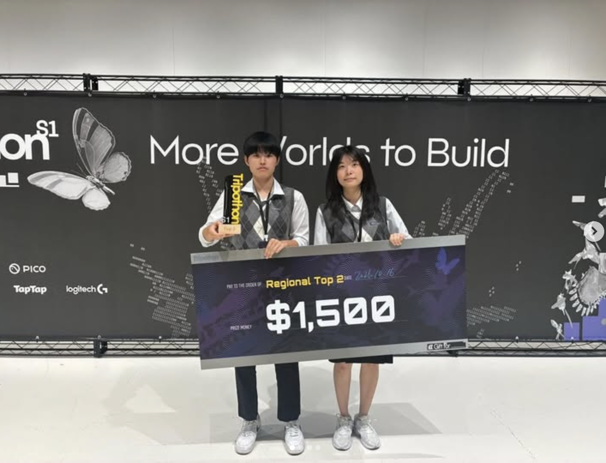
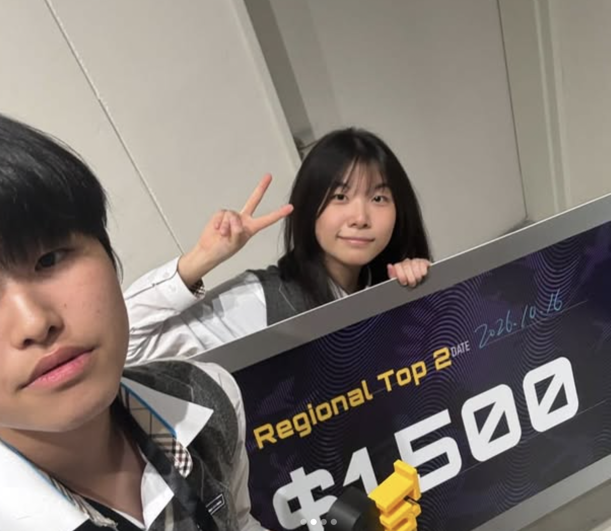

[← Tripothon S1 전체 기록](index.md)

> **2026-10-16 · 사진에서 시작한 웹 프로젝트가 현장 수상으로**

## 서울에서 이음을 소개하다

Tripothon S1 서울 데모데이에 참여해 이음을 소개했다. 개발 화면 안에서 다루던 아이디어를 현장에서 설명하고 보여주는 경험이었다. 사진 속 반려동물의 모습을 공간에 옮기고, 보호자가 함께했던 일상의 순간을 이어갈 수 있도록 만든 이유를 전달했다.

## 결과

**Tripothon S1 · Regional Top 2 수상 · 상금 $1,500**

현장 수상 사진의 보드에는 ‘Regional Top 2’, ‘$1,500’, 날짜 ‘2026.10.16’이 적혀 있다. 이 글에서는 그 표기대로 기록한다. 글로벌 전체 2위나 특정 툴 트랙 수상으로 확대해서 표현하지 않는다.

## 수상 현장

_Tripothon S1 수상 기념 사진._

_수상 보드에서 2026년 10월 16일과 상금 $1,500을 확인할 수 있다._

## 이 경험의 의미

기획부터 API 연결, 3D 상호작용, 오류 수정, 발표 준비와 현장 참여까지 이어 갔고 수상이라는 결과를 얻었다. 동시에 수상은 모든 기능과 모델의 완성을 뜻하지 않았다. 현장에서의 성과를 기록하면서도, 이후 실제 사용자 모델에서 드러난 문제를 계속 고치는 과정이 이어졌다.

**날짜 근거:** 참가자 제공 현장 사진의 날짜와 대회 공식 서울 행사 안내.
